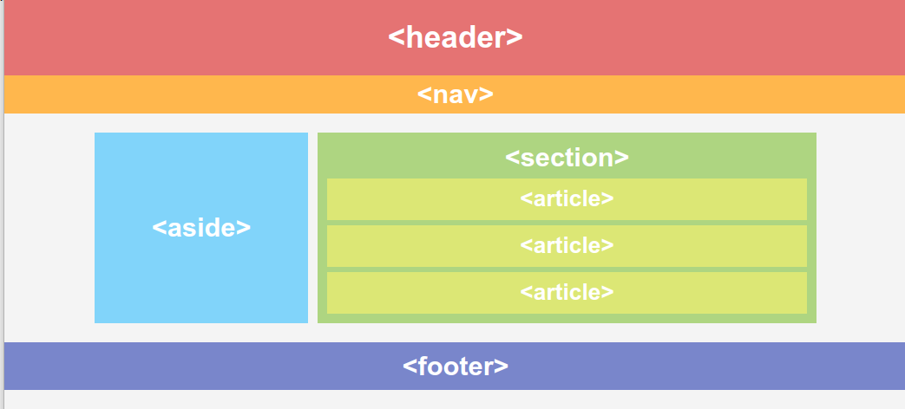

* Taula de continguts
{:toc}

---

# Elements semàntics d’estructura en HTML

Les **etiquetes semàntiques en HTML** són elements que descriuen el significat i la funció del contingut que contenen. Permeten que els navegadors, les tecnologies d’assistència i els motors de cerca interpreten millor l’estructura d’una pàgina.

A diferència d’elements genèrics com `<div>` o `<span>`, que permeten agrupar contingut però no indiquen quina funció té, els elements semàntics identifiquen clarament les diferents parts del document.

Això facilita:

- L’accessibilitat.
- La interpretació del contingut per part dels motors de cerca.
- La lectura i el manteniment del codi.

No obstant això, utilitzar elements semàntics no garanteix per si mateix una millora del rendiment ni del posicionament en els cercadors.

## Organització dels elements semàntics

{: .align-center }


---

## 1. `<header>`

L’element `<header>` s’utilitza per **definir la capçalera d’una pàgina o d’una secció**.

Normalment, conté elements introductoris, com ara:

- Un títol o subtítol.
- Un logotip.
- Un menú de navegació.
- Un formulari de cerca.
- Altres elements relacionats amb la introducció del contingut.

Una pàgina pot tindre més d’un `<header>`, ja que una secció o un article també poden tindre la seua pròpia capçalera.

**Exemple:**

```html
<header>
  <h1>Benvinguts al meu lloc web</h1>

  <nav>
    <ul>
      <li><a href="#">Inici</a></li>
      <li><a href="#">Serveis</a></li>
      <li><a href="#">Contacte</a></li>
    </ul>
  </nav>
</header>
```

---

## 2. `<nav>`

L’element `<nav>` s’utilitza per **identificar una secció que conté enllaços importants de navegació**.

Es pot utilitzar, per exemple, per representar:

- El menú principal de la pàgina.
- Un índex de continguts.
- Un menú de navegació secundari.
- La paginació entre diferents pàgines.
- Un conjunt d’enllaços per desplaçar-se per una secció.

No tots els grups d’enllaços d’una pàgina han d’estar dins d’un `<nav>`. Aquest element s’ha de reservar per als blocs de navegació importants.

**Exemple:**

```html
<nav>
  <ul>
    <li><a href="#">Inici</a></li>
    <li><a href="#">Serveis</a></li>
    <li><a href="#">Contacte</a></li>
  </ul>
</nav>
```

**Notes:**

- `<nav>` pot aparéixer dins de `<header>` o `<footer>`, però també pot ser una secció independent.
- La seua ubicació dependrà de l’estructura i del disseny de la pàgina.
- Els enllaços que formen part del contingut normal, com els que apareixen dins d’un paràgraf, no necessiten estar dins d’un `<nav>`.

---

## 3. `<main>`

L’element `<main>` defineix el **contingut principal d’una pàgina**.

Ha de contindre la informació pròpia, única i essencial del document. No hauria d’incloure contingut que es repetisca en diferents pàgines del mateix lloc web, com ara la capçalera general, el menú principal o el peu de pàgina.

En un document no ha d’haver-hi més d’un element `<main>` visible. Només podrien existir altres elements `<main>` si estan ocults mitjançant l’atribut `hidden`.

Aquest element facilita que els navegadors i les tecnologies d’assistència identifiquen ràpidament el contingut principal.

**Exemple:**

```html
<main>
  <h2>Notícies recents</h2>
  <p>Últimes notícies sobre el tema...</p>
</main>
```

---

## 4. `<section>`

L’element `<section>` s’utilitza per **agrupar contingut relacionat temàticament dins d’un document o una aplicació**.

Permet dividir una pàgina en parts lògiques, com ara:

- Una introducció.
- Un apartat de notícies.
- Una secció de serveis.
- Un bloc de preguntes freqüents.
- Un capítol o apartat d’un document.

Normalment, cada `<section>` ha de tindre un encapçalament que identifique el seu contingut.

No s’ha d’utilitzar `<section>` únicament per aplicar estils CSS o per agrupar elements sense una relació temàtica. En eixe cas, és més adequat utilitzar `<div>`.

**Exemple:**

```html
<section>
  <h2>Notícies de l’empresa</h2>
  <p>Informació sobre les novetats de l’empresa...</p>
</section>
```

---

## 5. `<article>`

L’element `<article>` defineix un **contingut independent i autosuficient**, que podria entendre’s, distribuir-se o reutilitzar-se fora de la pàgina en la qual apareix.

Es pot utilitzar per representar:

- Un article d’un blog.
- Una notícia.
- Una publicació en un fòrum.
- Un comentari d’un usuari.
- Una fitxa de producte.
- Una entrada individual d’una pàgina.

**Exemple:**

```html
<article>
  <h3>Nou article sobre tecnologia</h3>
  <p>
    En aquest article explorarem les últimes innovacions
    tecnològiques...
  </p>
</article>
```

> **Nota:** Si diversos elements `<article>` formen una agrupació temàtica amb un títol comú, es poden incloure dins d’un `<section>`. No obstant això, no és obligatori: també poden aparéixer directament dins de `<main>` o dins d’una altra secció.

La diferència principal és que un `<article>` representa un contingut que pot tindre sentit per si mateix, mentre que una `<section>` representa una part temàtica d’un conjunt major.

---

## 6. `<aside>`

L’element `<aside>` s’utilitza per **definir contingut relacionat de manera indirecta o tangencial amb el contingut que l’envolta**, i que es podria considerar separadament.

Pot contindre, per exemple:

- Informació complementària.
- Enllaços relacionats.
- Una biografia breu de l’autor.
- Publicitat.
- Una cita destacada.
- Un glossari o una explicació addicional.

**Exemple:**

```html
<aside>
  <h2>Enllaços relacionats</h2>
  <p>
    <a href="#">Més informació sobre tecnologia</a>
  </p>
</aside>
```

> **Nota:** `<aside>` descriu la funció del contingut, però no la seua posició visual. Sovint es representa com una barra lateral, però també pot aparéixer en qualsevol altra posició de la pàgina.

`<aside>` no substitueix `<section>` ni `<div>` quan el contingut forma part del flux principal de la pàgina.

---

## 7. `<footer>`

L’element `<footer>` defineix el **peu d’una pàgina o d’una secció**.

Normalment, pot contindre:

- Informació sobre l’autoria.
- Drets d’autor.
- Informació de contacte.
- Enllaços relacionats.
- La política de privacitat.
- Les condicions d’ús.
- Informació sobre la data de publicació o actualització.

Una pàgina pot tindre més d’un `<footer>`. Per exemple, tota la pàgina pot tindre un peu general i cada `<article>` pot tindre el seu propi peu.

**Exemple:**

```html
<footer>
  <p>© 2026 Nom de l’empresa. Tots els drets reservats.</p>
</footer>
```

---

## Beneficis de l’ús d’elements semàntics

1. **Milloren l’accessibilitat:** les tecnologies d’assistència, com els lectors de pantalla, poden interpretar millor l’estructura de la pàgina i permetre una navegació més clara.

2. **Faciliten la interpretació pels cercadors:** els motors de cerca poden comprendre millor l’estructura i el context del contingut. No obstant això, l’ús d’elements semàntics no garanteix per si mateix un millor posicionament.

3. **Produeixen un codi més clar i fàcil de mantindre:** permeten identificar ràpidament la funció de cada part de la pàgina i redueixen l’ús de contenidors genèrics sense significat.

4. **Faciliten el treball en equip:** altres desenvolupadors poden entendre l’estructura del document sense haver d’analitzar classes o identificadors CSS.

---
