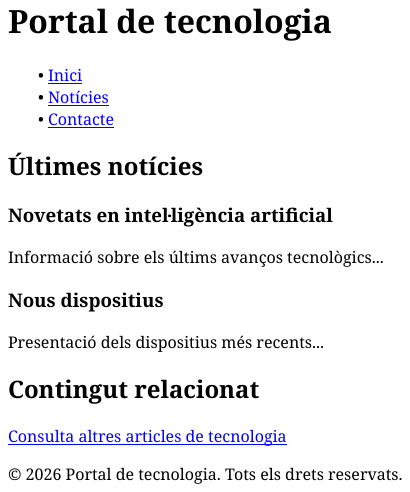
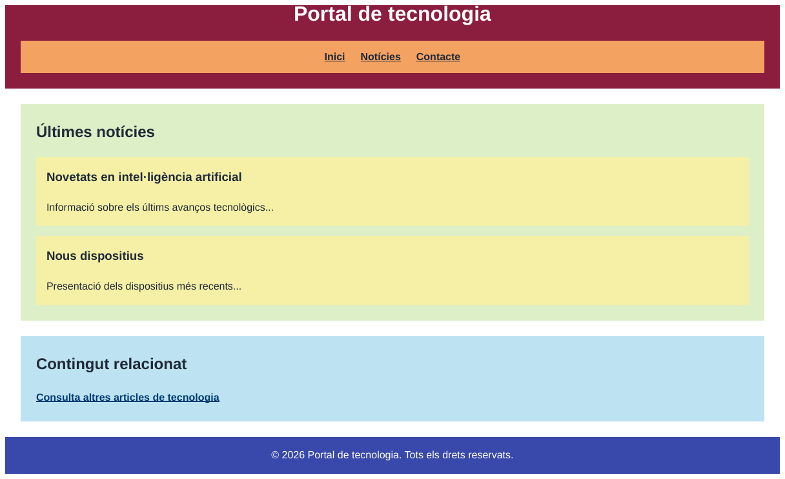
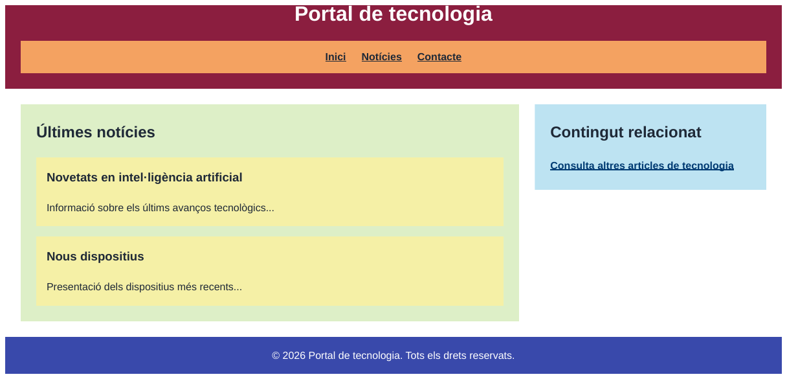

* Taula de continguts
{:toc}

---

# Exemple guiat d’HTML semàntic i CSS

Els tres exemples següents utilitzen **el mateix contingut i la mateixa estructura semàntica**. L’únic que canvia és la manera d’aplicar els estils. Això permet diferenciar clarament:

- **HTML semàntic:** defineix el significat i l’organització del contingut.
- **CSS:** controla la presentació i la distribució visual.

---

## Exemple 1: HTML semàntic sense CSS personalitzat

Aquest primer exemple utilitza elements semàntics com `<header>`, `<nav>`, `<main>`, `<section>`, `<article>`, `<aside>` i `<footer>`, però no incorpora CSS personalitzat.

El navegador aplica els seus **estils predeterminats**: marges, grandàries dels encapçalaments, vinyetes de la llista i aparença dels enllaços. Per tant, la pàgina ja té una presentació bàsica, encara que nosaltres no hàgem escrit cap regla CSS.

> **Important:** els elements semàntics aporten significat i estructura, però no determinen per si mateixos el disseny visual de la pàgina.

```html
<!DOCTYPE html>
<html lang="ca">
<head>
  <meta charset="UTF-8">
  <meta name="viewport" content="width=device-width, initial-scale=1.0">
  <title>Portal de tecnologia</title>
</head>

<body>
  <header>
    <h1>Portal de tecnologia</h1>

    <nav>
      <ul>
        <li><a href="#">Inici</a></li>
        <li><a href="#">Notícies</a></li>
        <li><a href="#">Contacte</a></li>
      </ul>
    </nav>
  </header>

  <main>
    <section>
      <h2>Últimes notícies</h2>

      <article>
        <h3>Novetats en intel·ligència artificial</h3>
        <p>Informació sobre els últims avanços tecnològics...</p>
      </article>

      <article>
        <h3>Nous dispositius</h3>
        <p>Presentació dels dispositius més recents...</p>
      </article>
    </section>

    <aside>
      <h2>Contingut relacionat</h2>
      <p><a href="#">Consulta altres articles de tecnologia</a></p>
    </aside>
  </main>

  <footer>
    <p>© 2026 Portal de tecnologia. Tots els drets reservats.</p>
  </footer>
</body>
</html>
```

---

{: .align-center }


---

## Exemple 2: HTML semàntic amb CSS en línia

En aquest exemple s’afig l’atribut `style` directament als elements HTML. El contingut i l’estructura semàntica són els mateixos que en l’exemple anterior, però ara s’incorporen colors, espaiats i ajustos tipogràfics.

Els estils en línia poden resultar útils en demostracions molt curtes, però mesclen l’estructura amb la presentació, repeteixen propietats i dificulten el manteniment del codi.

```html
<!DOCTYPE html>
<html lang="ca">
<head>
  <meta charset="UTF-8">
  <meta name="viewport" content="width=device-width, initial-scale=1.0">
  <title>Portal de tecnologia</title>
</head>

<body style="font-family: Arial, sans-serif; line-height: 1.6; margin: 0; color: #1f2937;">
  <header style="background-color: #8b1e3f; padding: 24px; color: white; text-align: center;">
    <h1 style="margin: 0;">Portal de tecnologia</h1>

    <nav style="background-color: #f4a261; padding: 12px; margin-top: 16px;">
      <ul style="display: flex; justify-content: center; gap: 24px; list-style: none; padding: 0; margin: 0;">
        <li><a href="#" style="color: #1f2937; font-weight: bold;">Inici</a></li>
        <li><a href="#" style="color: #1f2937; font-weight: bold;">Notícies</a></li>
        <li><a href="#" style="color: #1f2937; font-weight: bold;">Contacte</a></li>
      </ul>
    </nav>
  </header>

  <main style="padding: 24px;">
    <section style="background-color: #ddefc7; padding: 24px; margin-bottom: 24px;">
      <h2 style="margin-top: 0;">Últimes notícies</h2>

      <article style="background-color: #f5f0a6; padding: 16px; margin-bottom: 16px;">
        <h3 style="margin-top: 0;">Novetats en intel·ligència artificial</h3>
        <p style="margin-bottom: 0;">Informació sobre els últims avanços tecnològics...</p>
      </article>

      <article style="background-color: #f5f0a6; padding: 16px;">
        <h3 style="margin-top: 0;">Nous dispositius</h3>
        <p style="margin-bottom: 0;">Presentació dels dispositius més recents...</p>
      </article>
    </section>

    <aside style="background-color: #bde3f2; padding: 24px;">
      <h2 style="margin-top: 0;">Contingut relacionat</h2>
      <p style="margin-bottom: 0;"><a href="#" style="color: #003b73; font-weight: bold;">Consulta altres articles de tecnologia</a></p>
    </aside>
  </main>

  <footer style="background-color: #3949ab; padding: 16px 24px; color: white; text-align: center;">
    <p style="margin: 0;">© 2026 Portal de tecnologia. Tots els drets reservats.</p>
  </footer>
</body>
</html>
```

---

{: .align-center }


---

## Exemple 3: HTML semàntic amb CSS intern

En aquest cas, les regles CSS es reuneixen dins de l’element `<style>` de la capçalera. El contingut HTML continua sent el mateix, però la presentació queda centralitzada i és més senzilla de modificar.

També s’afig una distribució adaptable: en pantalles amples, la secció principal i el contingut complementari apareixen en columnes; en pantalles estretes, es col·loquen l’un davall de l’altre.

> **Nota:** el CSS intern és adequat per a aquest exemple autocontingut. En un lloc web amb diverses pàgines, normalment convé utilitzar un full d’estil extern per reutilitzar les mateixes regles.

```html
<!DOCTYPE html>
<html lang="ca">
<head>
  <meta charset="UTF-8">
  <meta name="viewport" content="width=device-width, initial-scale=1.0">
  <title>Portal de tecnologia</title>

  <style>
    *,
    *::before,
    *::after {
      box-sizing: border-box;
    }

    body {
      margin: 0;
      color: #1f2937;
      font-family: Arial, sans-serif;
      line-height: 1.6;
    }

    header {
      padding: 24px;
      color: white;
      text-align: center;
      background-color: #8b1e3f;
    }

    header h1 {
      margin: 0;
    }

    nav {
      padding: 12px;
      margin-top: 16px;
      background-color: #f4a261;
    }

    nav ul {
      display: flex;
      flex-wrap: wrap;
      justify-content: center;
      gap: 24px;
      padding: 0;
      margin: 0;
      list-style: none;
    }

    nav a {
      color: #1f2937;
      font-weight: bold;
    }

    main {
      display: flex;
      align-items: flex-start;
      gap: 24px;
      padding: 24px;
    }

    section {
      flex: 1 1 70%;
      padding: 24px;
      background-color: #ddefc7;
    }

    section h2,
    aside h2,
    article h3 {
      margin-top: 0;
    }

    article {
      padding: 16px;
      margin-bottom: 16px;
      background-color: #f5f0a6;
    }

    article:last-child {
      margin-bottom: 0;
    }

    article p,
    aside p {
      margin-bottom: 0;
    }

    aside {
      flex: 1 1 30%;
      padding: 24px;
      background-color: #bde3f2;
    }

    aside a {
      color: #003b73;
      font-weight: bold;
    }

    footer {
      padding: 16px 24px;
      color: white;
      text-align: center;
      background-color: #3949ab;
    }

    footer p {
      margin: 0;
    }

    @media (max-width: 700px) {
      main {
        flex-direction: column;
      }

      section,
      aside {
        width: 100%;
      }
    }
  </style>
</head>

<body>
  <header>
    <h1>Portal de tecnologia</h1>

    <nav>
      <ul>
        <li><a href="#">Inici</a></li>
        <li><a href="#">Notícies</a></li>
        <li><a href="#">Contacte</a></li>
      </ul>
    </nav>
  </header>

  <main>
    <section>
      <h2>Últimes notícies</h2>

      <article>
        <h3>Novetats en intel·ligència artificial</h3>
        <p>Informació sobre els últims avanços tecnològics...</p>
      </article>

      <article>
        <h3>Nous dispositius</h3>
        <p>Presentació dels dispositius més recents...</p>
      </article>
    </section>

    <aside>
      <h2>Contingut relacionat</h2>
      <p><a href="#">Consulta altres articles de tecnologia</a></p>
    </aside>
  </main>

  <footer>
    <p>© 2026 Portal de tecnologia. Tots els drets reservats.</p>
  </footer>
</body>
</html>
```

---

{: .align-center }


---

## Conclusió

Els tres exemples comparteixen la mateixa estructura semàntica, però presenten diferents graus d’organització visual:

1. Sense CSS personalitzat, el navegador mostra el document amb els seus estils predeterminats.
2. El CSS en línia permet aplicar estils ràpidament, però mescla la presentació amb l’HTML i dificulta el manteniment.
3. El CSS intern centralitza les regles i permet crear una distribució coherent i adaptable.

L’HTML semàntic descriu **què representa cada part del contingut**. El CSS determina **com es presenta eixe contingut**. Mantindre separades aquestes responsabilitats facilita la lectura, la reutilització i el manteniment del projecte.

---
