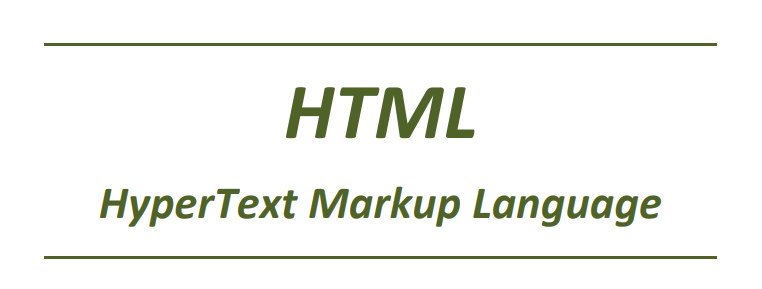
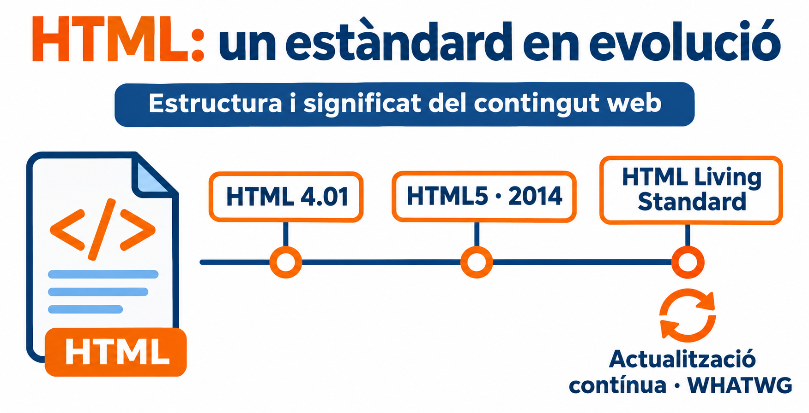
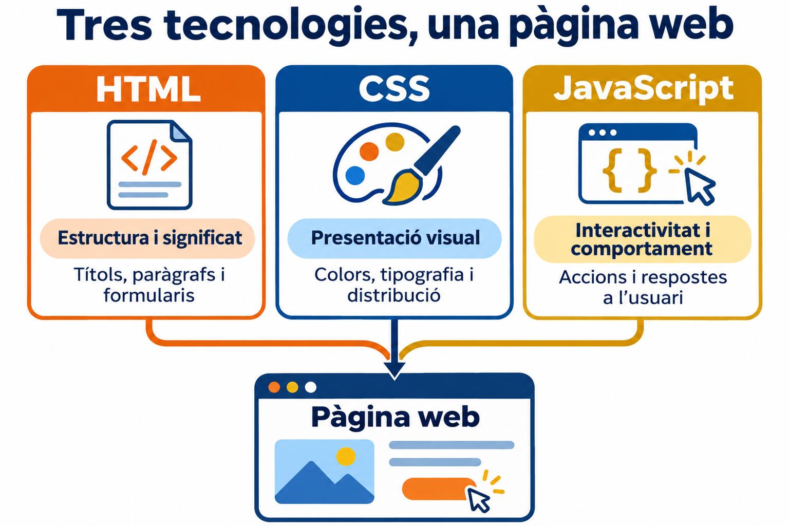

---

title: 2.- HTML
layout: default
parent: Llenguatges de Marques
nav_order: 30
has_children: true
has_toc: true

---


{: .text-center }



{:toc}
    


# Introducció

**HTML (HyperText Markup Language)** és el llenguatge de marques que utilitzem per a definir **l’estructura i el contingut d’una pàgina web**.

El terme **hipertext** fa referència a text amb enllaços que permeten navegar entre documents o recursos de la web.

**HTML no és un llenguatge de programació**: descriu l’estructura i el significat del contingut mitjançant marques. Per a expressar algoritmes i programar comportaments, utilitzem llenguatges com JavaScript.

Mitjançant **etiquetes**, indiquem quina funció té cada part del document: un títol, un paràgraf, una imatge, un enllaç, una llista o un formulari. Els navegadors interpreten aquestes etiquetes per a presentar el contingut als usuaris.

Podem imaginar HTML com **l’esquelet d’una pàgina web**: organitza el contingut i aporta significat a cadascuna de les seues parts.

## Un poc d’història

HTML va nàixer a principis dels anys noranta, creat per **Tim Berners-Lee** per a compartir documents connectats mitjançant enllaços.

Amb el creixement de la web, el llenguatge va evolucionar a través de versions com **HTML 2.0**, **HTML 3.2** i **HTML 4.01**.

L’any **2014**, el W3C va publicar HTML5 com a recomanació. Aquesta versió va representar una fita important: va incorporar elements semàntics com `<main>`, `<section>` i `<article>`, i va facilitar la inclusió d’àudio i vídeo amb `<audio>` i `<video>`.

## L’estàndard actual: HTML Living Standard

Actualment, HTML es desenvolupa com un **estàndard viu**, anomenat **HTML Living Standard**, mantingut per **WHATWG**.

Això significa que l’especificació s’actualitza contínuament amb millores i correccions, sense esperar la publicació de noves versions numerades.

El nom **HTML5** continua sent habitual per a referir-se a l’HTML modern, però la referència actual és l’[HTML Living Standard](https://html.spec.whatwg.org/).

En els documents utilitzarem aquesta declaració:

```html
<!DOCTYPE html>
```

Aquesta declaració permet que el navegador interprete la pàgina en mode estàndard.

{: .text-center }


## HTML, CSS i JavaScript

Per a construir una pàgina web, combinem tecnologies que tenen funcions diferents:

| Tecnologia | Funció |
|---|---|
| **HTML** | Defineix l’estructura i el significat del contingut. |
| **CSS** | Controla la presentació: colors, tipografia, espais i distribució. |
| **JavaScript** | Programa el comportament i la interactivitat. |

A més, els navegadors ofereixen **APIs web** que permeten treballar amb funcionalitats com la geolocalització, la càmera o l’emmagatzematge de dades.

Aquestes tecnologies treballen conjuntament. Per exemple, en un formulari, **HTML** defineix els camps i el botó, **CSS** en determina l’aparença i **JavaScript** pot comprovar les dades i mostrar missatges mentre l’usuari l’emplena.

{: .text-center }

